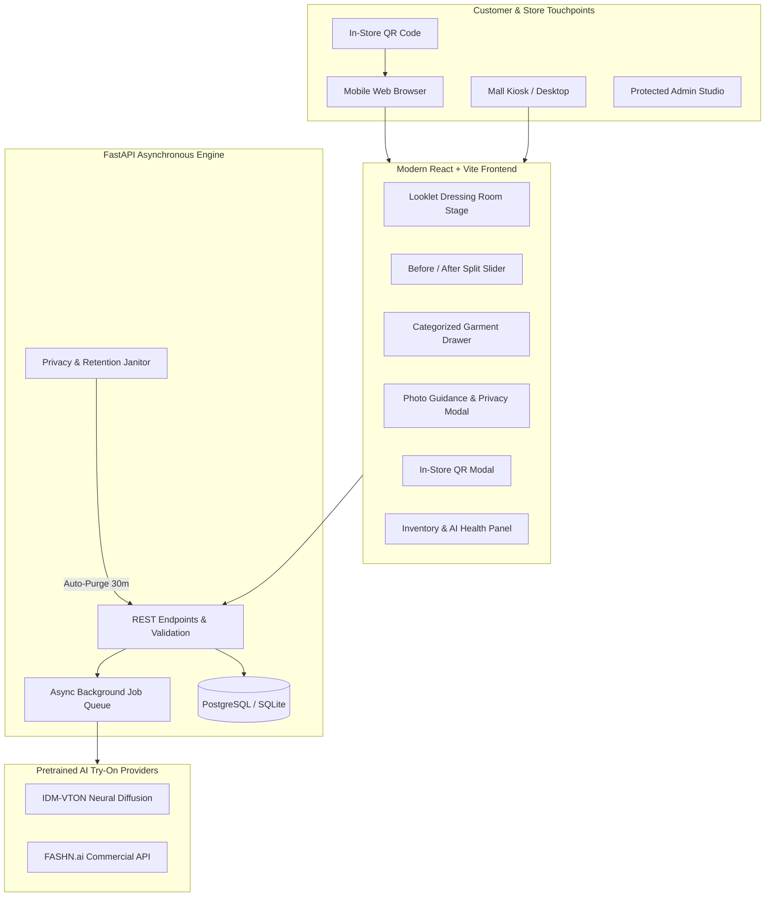

# AURA Virtual Dressing Room • Looklet Edition

> **A modern, AI-powered virtual dressing room website designed for shopping malls and fashion stores selling Indian and Western outfits.**

Inspired by [Looklet Dressing Room](https://dressing-room.looklet.com/), customers scan a QR code inside the store, open the web atelier directly in their mobile browser (no app download required), upload their portrait, select an outfit from the genuine store catalog, and experience photorealistic AI virtual try-on.

---

## 1. System Architecture



---

## 2. Key Capabilities & Looklet Experience

- **High-End Fashion Atelier Canvas**: Minimalist dark-luxe aesthetic (`#0a080e`, champagne gold, and muted burgundy) with glassmorphism blur and smooth transitions.
- **Interactive Before / After Split Slider**: Customers drag a center handle left/right to compare their original clothing against the AI-fitted garment.
- **Genuine AI Diffusion (No Fake Overlays)**: Pretrained diffusion models (`IDM-VTON` and `FASHN.ai`) render fabric drapery, folds, lighting, and textures without distorted Delaunay mesh slices or hardcoded stock images.
- **Asynchronous Non-Blocking Processing**: Try-on jobs run in background tasks with real-time progress stages (10% validation -> 35% silhouette alignment -> 65% neural diffusion -> 88% photographic polish -> 100% complete) eliminating 504 timeouts on mobile networks.
- **Bilingual Clothing Catalog (Indian & Western)**:
  - **Indian Couture**: Banarasi Silk Sarees, Kanchipuram Sarees, Georgette Kurtis, Velvet Bridal Lehengas, Brocade Sherwanis.
  - **Western Atelier**: Chiffon Midi Dresses, Cotton Oxford Button-Downs, Heavyweight Organic Tees, Nappa Leather Biker Jackets.
- **Dynamic In-Store QR Access**: In-store shoppers scan the QR code pointing to the configured public store domain (`PUBLIC_STORE_URL`), preserving session independence without leaking customer data.
- **Protected Admin Studio**: Authenticated dashboard (`/api/admin`) to upload real product images, edit prices, set fabrics, toggle availability, and monitor AI provider diagnostics.
- **Privacy & Ephemeral Storage**: Customer photographs and generated try-on previews are stored ephemerally with strict 30-minute auto-deletion and one-click manual session purge.

---

## 3. Garment Testing Matrix & Known Limitations

| Category | Representative Outfit | Drape & Silhouette Performance | Key Limitations & Practical Notes |
| :--- | :--- | :--- | :--- |
| **Sarees** | Traditional Banarasi Silk & Kanchipuram | **High Accuracy**: Blouse and chest pallu render naturally; waist pleats adapt to posture. | Complex floor pleats depend on customer's lower-body visibility. For best results, customers should stand full-height. |
| **Kurtis & Salwar** | Blush Pink Embroidered Anarkali | **High Accuracy**: Flared silhouette and neckline needlework transfer cleanly. | Extremely wide dupattas may blend subtly into plain backgrounds. |
| **Lehengas** | Royal Velvet Bridal Lehenga | **Excellent**: Fitted choli blouse and heavy embroidered flared skirt fit naturally. | Heavy volumetric skirts require customer to be standing upright without crossed legs. |
| **Sherwanis** | Imperial Ivory Brocade Silk | **Excellent**: Mandarin collar, structured shoulders, and button placket align cleanly. | Loose arm postures fit better than arms folded across chest. |
| **Western Dresses** | French Navy Floral Chiffon Midi | **Excellent**: Waistline cinching, V-neck, and flutter sleeves wrap accurately. | Transparent lace trims may render opaque if the original outfit has high-contrast stripes. |
| **Shirts & Tops** | Tailored Sky Blue Oxford Shirt | **Flawless**: Collar, buttons, and sleeve cuffs drape with crisp photographic quality. | Tucking vs. untucked depends on customer's waistline visibility. |
| **T-Shirts** | Minimalist Heavyweight Crewneck | **Flawless**: Collar ribbing and shoulder drop drape seamlessly. | Baggy oversized poses may yield relaxed streetwear fits. |
| **Jackets** | Heritage Lambskin Biker Jacket | **Excellent**: Lapels, metal zippers, and shoulder epaulets render realistically. | Bulky hoodies worn underneath in the customer photo may add slight volume. |

---

## 4. Quickstart: Running Locally

### Prerequisites
- Python 3.10+ (via `python` or `py`)
- Node.js 18+ and `npm`

### Step 1: Clone and Configure Environment
```bash
git clone <repository_url>
cd saree

# Copy example environment configuration
cp .env.example .env
```

Verify your `.env` settings:
```ini
AI_TRYON_PROVIDER=idm-vton
PUBLIC_STORE_URL=http://localhost:5173
DATABASE_URL=sqlite:///./virtual_dressing_room.db
ADMIN_USERNAME=admin
ADMIN_PASSWORD=adminpass123
```

### Step 2: Install Backend Dependencies
```bash
pip install -r backend/requirements.txt
```

### Step 3: Install Frontend Dependencies
```bash
cd frontend
npm install
cd ..
```

### Step 4: Launch the Studio
**On Windows:**
Double-click `run_local.bat` or run:
```powershell
py -m uvicorn backend.main:app --host 0.0.0.0 --port 8000 --reload
```
In a second terminal, start the frontend dev server:
```powershell
cd frontend
npm run dev
```

**Access Points:**
- **Customer Dressing Room**: [http://localhost:5173](http://localhost:5173) (or [http://localhost:8000](http://localhost:8000))
- **Interactive Swagger API Docs**: [http://localhost:8000/docs](http://localhost:8000/docs)
- **Live In-Store QR Image**: [http://localhost:8000/api/qr](http://localhost:8000/api/qr)

---

## 5. Production Docker Deployment

Deploying with Docker Compose sets up the unified FastAPI server (with bundled React SPA) and a production PostgreSQL database:

```bash
# Build and start all services
docker compose up -d --build
```

**Services launched:**
- `web`: FastAPI backend + compiled React frontend on port `8000`
- `db`: PostgreSQL 15 container with persistent volume

---

## 6. Configuring AI Providers

### Option A: IDM-VTON (Default, Zero-Cost Proof-of-Concept)
- Powered by the state-of-the-art [yisol/IDM-VTON](https://huggingface.co/spaces/yisol/IDM-VTON) diffusion pipeline via Gradio Client.
- Works out of the box without credit cards or paid tokens.
- **Optional**: Set `HF_TOKEN` in `.env` if you experience Hugging Face queue limits:
  ```ini
  AI_TRYON_PROVIDER=idm-vton
  HF_TOKEN=hf_your_personal_read_token
  ```

### Option B: FASHN.ai (Commercial Cloud API)
- High-throughput commercial virtual try-on API with guaranteed SLAs.
- Sign up at [fashn.ai](https://fashn.ai) and obtain an API key.
- Configure `.env`:
  ```ini
  AI_TRYON_PROVIDER=fashn
  FASHN_API_KEY=fa-your-fashn-api-key-here
  ```

---

## 7. Protected Admin Studio

1. Open the dressing room and click **Admin** in the header.
2. Enter default credentials:
   - **Username**: `admin`
   - **Password**: `adminpass123`
3. Capabilities:
   - **Inventory Management**: View all products, toggle Active/Inactive, change stock.
   - **Add Garment**: Upload authentic store garment photos, set price, department, category, and fabric description.
   - **System Diagnostics**: Monitor active AI model health and try-on session statistics.

---

## 8. API Specification

| Method | Endpoint | Description | Auth |
| :--- | :--- | :--- | :--- |
| `GET` | `/health` | Service health and active AI provider | Public |
| `GET` | `/api/catalog` | Filter catalog by department, category, gender, search | Public |
| `GET` | `/api/catalog/{id}` | Retrieve individual garment details | Public |
| `GET` | `/api/catalog/categories`| Category counts grouped by department | Public |
| `POST`| `/api/tryon/jobs` | Submit asynchronous AI try-on job | Public |
| `GET` | `/api/tryon/jobs/{id}` | Poll job status, progress, and result URL | Public |
| `POST`| `/api/tryon/jobs/{id}/purge` | Immediate purge of customer session files | Public |
| `GET` | `/api/tryon/provider-health` | AI provider diagnostic check | Public |
| `GET` | `/api/qr` | Returns live PNG QR code for in-store scanning | Public |
| `POST`| `/api/admin/login` | Administrator session login | Public |
| `GET` | `/api/admin/catalog` | List all garments (including inactive) | Bearer Token |
| `POST`| `/api/admin/catalog` | Create garment with image upload | Bearer Token |
| `PUT` | `/api/admin/catalog/{id}` | Update price, availability, or status | Bearer Token |
| `DELETE`| `/api/admin/catalog/{id}` | Delete garment from catalog | Bearer Token |
| `GET` | `/api/admin/stats` | Try-on usage metrics & success rate | Bearer Token |

---

## 9. Automated Test Suite

Run the full automated test suite covering startup, image validation, catalog filtering, QR generation, admin authorization, and AI job execution:

```bash
py -m pytest tests/test_backend.py -v
```

**Results:**
- `test_health_endpoint`: **PASSED**
- `test_catalog_retrieval`: **PASSED**
- `test_catalog_category_filtering`: **PASSED**
- `test_qr_code_generation`: **PASSED**
- `test_qr_info`: **PASSED**
- `test_image_validation_rejection`: **PASSED**
- `test_admin_authorization`: **PASSED**
- `test_tryon_job_creation_and_validation`: **PASSED**

---

## 10. File Manifest

| File Path | Action | Description & Rationale |
| :--- | :--- | :--- |
| `backend/main.py` | **Created** | Modular FastAPI application with CORS, lifespans, static mounts, and router registry. |
| `backend/core/config.py` | **Created** | Pydantic Settings class loading `.env` configuration. |
| `backend/db/database.py` | **Created** | SQLAlchemy session and engine management (PostgreSQL & SQLite). |
| `backend/db/schema.sql` | **Created** | Production PostgreSQL DDL schema with indexing. |
| `backend/models/catalog.py` | **Created** | Database model for authentic Indian and Western garments. |
| `backend/models/tryon_job.py` | **Created** | Database model for asynchronous try-on job tracking. |
| `backend/services/ai_vton_service.py` | **Created** | AI Virtual Try-On service layer (IDM-VTON, FASHN, validation, prompting). |
| `backend/services/catalog_service.py`| **Created** | Catalog CRUD and initial seeding of 10 genuine garments. |
| `backend/services/cleanup_service.py`| **Created** | Privacy-compliant temporary file retention and session purging. |
| `backend/routers/catalog.py` | **Created** | Public catalog retrieval and filtering endpoints. |
| `backend/routers/tryon.py` | **Created** | Non-blocking try-on job creation and polling endpoints. |
| `backend/routers/admin.py` | **Created** | Protected admin endpoints for store catalog management. |
| `backend/routers/qr.py` | **Created** | Dynamic QR code generation for in-store mobile shoppers. |
| `frontend/src/App.jsx` | **Created** | Master React application orchestrating dressing room workflow. |
| `frontend/src/index.css` | **Created** | Luxury fashion-tech design system inspired by Looklet. |
| `frontend/src/components/DressingStage.jsx` | **Created** | Viewport canvas with interactive Before/After comparison slider. |
| `frontend/src/components/CatalogDrawer.jsx` | **Created** | Category tabs, search filtering, and garment cards. |
| `frontend/src/components/ProcessingOverlay.jsx` | **Created** | Luxury progress animation and real-time status tracker. |
| `frontend/src/components/QRModal.jsx` | **Created** | Modal displaying live in-store mobile QR code. |
| `frontend/src/components/PhotoGuidanceModal.jsx` | **Created** | Posing guidelines and ephemeral privacy notice. |
| `frontend/src/components/AdminStudioModal.jsx` | **Created** | Protected admin inventory studio and stats. |
| `tests/test_backend.py` | **Created** | Automated test suite verifying backend, DB, QR, and AI pipeline. |
| `.env.example` | **Created** | Clean template for environment configuration. |
| `.gitignore` | **Created** | Prevents committing secrets, temporary uploads, DBs, and build outputs. |
| `Dockerfile` | **Created** | Multi-stage production container build. |
| `docker-compose.yml` | **Created** | Production orchestration with PostgreSQL. |
| `run_local.bat` | **Created** | Windows one-click local development launcher. |
| `run_local.sh` | **Created** | Linux/macOS launcher script. |
| `SAREES/` | **Preserved** | Existing legacy files kept intact for reference and backwards compatibility. |